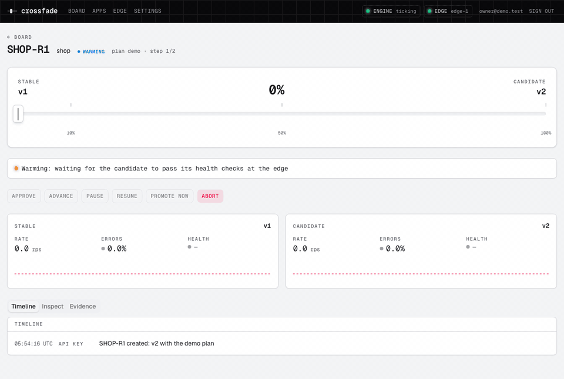
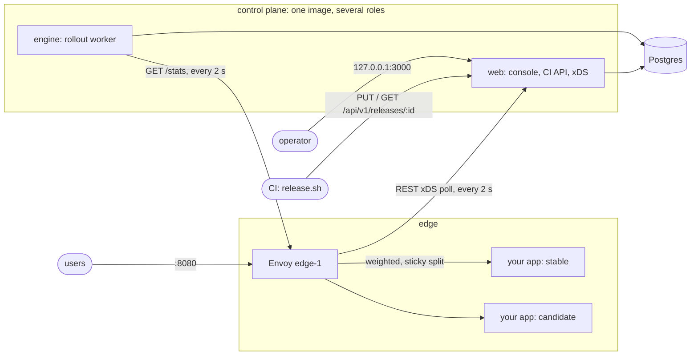

# Crossfade

[](https://github.com/NecmiKural/crossfade/actions/workflows/ci.yml)
[](LICENSE)

**Canary releases with automatic rollback for plain Docker hosts.** Crossfade puts Envoy in front of your containers, moves traffic from the stable version to a candidate in steps, and rolls back on its own when the candidate starts failing. It also files an incident card with the evidence. A small Sovereign-style control plane drives it, along with a release board in the spirit of Jira.



_The demo: v2 fails 30% of its requests, so Crossfade rolls it back at 10% traffic and files SHOP-1. v3 is clean, so it goes 10% → 50% → promoted, and SHOP-1 resolves itself._

## Why

Metric-gated canaries with automatic rollback are well covered on Kubernetes (Argo Rollouts, Flagger) and on some hosted platforms. On a plain Docker host there is little to reach for: Kayenta is archived, and a typical Compose deploy swaps every request to the new version at once.

Crossfade fills that gap with a stack you start with `docker compose up`:

- **No app changes.** Health checks, error counting and access logs live in Envoy. The canary verdict uses Envoy's own per-cluster counters, so there is no Prometheus to run and no SDK to add.
- **Three gates per step.**
  - **Health:** a candidate gets 0% of traffic until Envoy reports it healthy.
  - **Convergence:** a step's bake timer starts only after Envoy has acknowledged the config revision for that step.
  - **Error budget:** the release rolls back when `5xx / completed` over the step goes above the plan's limit.
- **CI-friendly.** An idempotent `PUT /api/v1/releases/:id` follows the async pattern of an Open Service Broker. `scripts/release.sh` exits 0 on promotion and 1 on rollback, so a pipeline retires the old container only after a verdict.
- **Fail-safe.** If the control plane goes down, Envoy keeps serving its last good config and the split stays where it was.

## Quick start

You need Docker with Compose v2 and about 2 GB of free disk for the build and the images.

```sh
git clone https://github.com/NecmiKural/crossfade && cd crossfade
docker compose --profile demo up -d --build --wait
docker compose logs migrate | grep setup     # prints a one-time setup URL
```

1. **Create the owner.** Open the setup URL, create the owner account, and you land on the release board.
2. **See the stable version.** <http://localhost:8080> serves the demo app `shop` on v1 (blue). A traffic generator sends about 40 requests per second with varied client IPs.
3. **Roll out a bad version.** In the console, click **Start release**, pick `v2` and the `demo` plan. Watch the release page:
   - warming → 10% → "Live on edge-1";
   - the v2 error line crosses the 2% budget;
   - rolled back, about 25 seconds after the start;
   - incident SHOP-1 appears on the board.
4. **Roll out a good version.** Start a release of `v3`. It moves 10% → 50% → promoted, and SHOP-1 shows "resolved by SHOP-R2".
5. **Drive it from CI instead.** Create an API key scoped to `shop` under **Settings**, then:

   ```sh
   CROSSFADE_API_KEY=cf_… ./scripts/release.sh shop v2; echo "exit $?"   # exit 1: rolled back
   ```

To stop the demo and remove its containers, networks and volumes, run `docker compose --profile demo down -v`.

## How a release moves

```
pending approval ─► warming ─► rolling: step 1 ─► step 2 ─► … ─► promoted
   (optional)          │            │ applying → live → baking  │
                       │            └──────── error budget ─────┴─► rolled back + incident
                       └─ never healthy / never reached the edge ─► rolled back / cancelled
```

Each step is **applying** (Envoy has not acked the new routes yet), then **live**, then **baking** for the step's duration. The engine checks every 2 seconds. At the end of the bake it advances only if enough requests came through. Otherwise it holds and says why. For example, "insufficient data, n=12 of 30" is shown on the release page and returned by the API. If the data still has not arrived after the plan's wait (2 minutes for `demo`, up to an hour for `cautious`), the release is cancelled: traffic goes back to stable and no incident is filed.

| Plan | Steps (weight / bake) | Minimum requests per step | Error budget | Advances |
|---|---|---|---|---|
| `demo` | 10% / 15 s, 50% / 15 s | 30 | 2% | automatically |
| `standard` | 5% / 2 min, 25% / 5 min, 50% / 5 min | 200 | 1% | automatically |
| `cautious` | 1% / 10 min, 5% / 15 min, 25% / 30 min, 50% / 30 min | 500 | 0.5% | automatically |
| `manual` | 10%, 50% | 30 | 2% | on a click (the error budget still rolls back) |

An app's default plan is a floor. A CI request may pick a more cautious plan, never a looser one.

**Controls.** A person can pause, resume, advance, promote now or abort a release from the console. Apps can require **four-eyes approval**: a release then waits until someone other than its creator (or the owner of the key that created it) approves it.

**Sticky split.** By default the split hashes the leftmost `X-Forwarded-For` address. A client gets the same version on every request, and when the weight grows, clients only move from stable to candidate, never back. That keeps single-page apps from mixing old and new assets. Turn it off per app for a random per-request split.

**Testers.** While a release is pending or warming, requests that carry `x-crossfade-tester: <token>` reach the candidate before any real user does. The header is stripped before the request reaches your app.

## Use it with your own app

1. **Allow the upstream.** Upstreams are deny-by-default. List the host and port slots each app may use in `.env`, next to `compose.yaml`:

   ```sh
   UPSTREAM_ALLOWLIST="shop=shop-blue:3000,shop-green:3000;blog=blog-a:8080,blog-b:8080"
   ```

2. **Join the network.** Run your containers on the `crossfade_apps` Docker network, so Envoy can reach them by name. Your app needs a health endpoint (default `/healthz`) that returns 200.
3. **Register the app.** Under **Apps**, add the app (slug, key such as `SHOP`, domain, path prefix) and register its first version. That version becomes stable.
4. **Release.** For each deploy, start the new build in the free slot. Then run `scripts/release.sh <app> <version> <host:port>`, which registers the version and rolls it out. Stop the old container only after exit 0.

[`examples/github-actions/release.yml`](examples/github-actions/release.yml) is a complete blue/green pipeline for a self-hosted runner. `GET /api/v1/plans` returns the plan catalogue and the JSON Schema of a release request.

## Architecture



- **Render on write.**
  - Every change (a console form, a CI request, an engine step) runs in one Postgres transaction: update the rows, render the Envoy clusters and routes from them, validate the result, and store it as a content-hashed snapshot.
  - Envoy polls `POST /v3/discovery:{clusters,routes}`. It gets a 304 when nothing changed, and the precomputed JSON when something did.
  - A config that fails validation never reaches Envoy, because the transaction rolls back.
- **A pure state machine.** The engine reads Envoy's counters before it opens a transaction. It then claims due releases with `FOR UPDATE SKIP LOCKED`, and runs `decide()`, a pure function with one table-driven test per rule.
- **One image, four roles.** `init` generates the secrets, `migrate` migrates the database and re-publishes the snapshot, `web` serves the console, API and xDS, and `engine` runs the rollouts. All four use the same build.
- **Three networks.** Your upstreams can reach Envoy, but not the database or the control plane. The dashboard and API listen on `127.0.0.1` only.

The reasoning behind each choice is in the [architecture decision records](docs/adr).

**Stack:** Next.js 16 (App Router, server actions), React 19, TypeScript, Postgres 18 with Drizzle, Better Auth, Tailwind CSS 4 and shadcn/ui, Envoy 1.39, Vitest.

## From the video

Crossfade started from [_I was laid off by Atlassian_](https://www.youtube.com/watch?v=55pTFVoclvE), a walkthrough by Vasilios Syrakis of the edge platform built at Atlassian. The video does not cover canary releases. Crossfade takes its architecture ideas and applies them to a problem small teams have.

| In the video | In Crossfade |
|---|---|
| [04:38](https://www.youtube.com/watch?v=55pTFVoclvE&t=278s) An Open Service Broker as the front door for provisioning | `PUT /api/v1/releases/:id`: idempotent create, 202 with `Retry-After`, 409 on conflicting reuse |
| [07:01](https://www.youtube.com/watch?v=55pTFVoclvE&t=421s) Broker → SQS → worker, clients poll for status | A Postgres work loop (`SKIP LOCKED`) worked by the `engine`, with CI polling `GET` |
| [11:42](https://www.youtube.com/watch?v=55pTFVoclvE&t=702s) Sovereign: templates plus context rendered for Envoy over REST xDS | Typed renderers over database rows produce content-hashed snapshots, served over REST xDS with 304s |
| [17:42](https://www.youtube.com/watch?v=55pTFVoclvE&t=1062s) Golden machine images | One immutable image with four roles; secrets generated at first start, never baked in |
| [22:05](https://www.youtube.com/watch?v=55pTFVoclvE&t=1325s) Private by default, public by explicit opt-in | A new version gets 0% until a release starts; a tester header reaches it first; optional four-eyes approval |
| [24:14](https://www.youtube.com/watch?v=55pTFVoclvE&t=1454s) Validating config before it ships | Every snapshot is validated in the writing transaction; CI runs `envoy --mode validate` on fixtures |
| [25:52](https://www.youtube.com/watch?v=55pTFVoclvE&t=1552s) Auth, rate limits and logging done once at the edge | Health checks, error counting and access logs live in Envoy, so apps need no changes |
| [32:18](https://www.youtube.com/watch?v=55pTFVoclvE&t=1938s) Owning a platform for the long run | Architecture decision records, pinned dependencies, a compose end-to-end test in CI |
| [33:27](https://www.youtube.com/watch?v=55pTFVoclvE&t=2007s) "Configuration that's valid, but destroys the traffic" | The whole point: health, convergence and error-budget gates with automatic rollback |

## Limits

These are worth knowing before you rely on Crossfade:

- **It has not been audited.** Treat v0.1.0 as a well-tested project, not a hardened product.
- **One edge node.** The engine reads counters from a single Envoy. The convergence gate already tracks every polling node.
- **The gates see only 5xx errors and health.** Latency, 4xx responses and client-side errors do not count. A version that is slow, or broken in the browser only, passes.
- **Quiet apps cannot be judged.** If a step never reaches its minimum request count, the engine refuses to guess: it holds, then cancels. Use the `manual` plan for apps with little traffic.
- **No TLS on the edge.** Put Caddy, Traefik or a load balancer in front (see below).
- **The verdict trusts `X-Forwarded-For`.** Clients choose their sticky bucket. That is fine for splitting traffic, but it is not a security boundary.
- **Cold start needs the control plane.** If Envoy restarts while `web` is down, it comes back with no routes until `web` returns. Restart the database, then `web`, and Envoy last.
- **Four-eyes approval stops mistakes, not a malicious admin.** An admin can create a second account.

## Hardening checklist

- **Terminate TLS in front.** Run a TLS proxy in front of Envoy and set:
  - `ENVOY_BOOTSTRAP=envoy.behind-proxy.yaml`, so Envoy trusts one `X-Forwarded-For` hop;
  - `EDGE_BIND=127.0.0.1`, so clients cannot bypass the proxy.
- **Keep the dashboard private.** Leave `DASHBOARD_BIND=127.0.0.1` and reach the console through an SSH tunnel or VPN. If you serve it on another origin, set `BETTER_AUTH_URL` to that exact origin.
- **Set your own allowlist.** `UPSTREAM_ALLOWLIST` should list only the slots your apps use.
- **Pick a real plan.** Give apps the `standard` or `cautious` plan. Turn on four-eyes approval where a second pair of eyes matters.
- **Check upstream keep-alive.** It must stay above 4 seconds (Node's default of 5 seconds is fine), or Envoy may reuse a closed connection.
- **Mind the timeout.** Routes time out after 60 seconds, and Crossfade never retries, so a retry can never hide a 5xx.
- **Back up both volumes.** Back up the database volume and the `secrets` volume. Losing `secrets` locks you out of the database and logs everyone out.
- **Mind the firewall.** Docker-published ports bypass `ufw`. Firewall at the host or provider level.
- **Read the runbook.** [docs/RUNBOOK.md](docs/RUNBOOK.md) covers failure modes, release holds, secret rotation, backup and restore, and owner lockout.
- **Read the threat model.** [SECURITY.md](SECURITY.md) lists what Crossfade defends against, its known limits, and how to report a vulnerability.

## Contributing

Issues and pull requests are welcome. [CONTRIBUTING.md](CONTRIBUTING.md) covers the local setup, the checks CI runs, and how code here is written.

## Credits

- **Vasilios Syrakis** ([vsyrakis.dev](https://vsyrakis.dev), [github.com/cetanu](https://github.com/cetanu)), whose talk is where the ideas here come from.
- **[Sovereign](https://bitbucket.org/atlassian/sovereign)** (Apache-2.0): Atlassian's open-source Envoy control plane. Crossfade's render-on-write, REST xDS design follows its approach. No Sovereign code is used.
- **Third-party components** used in the UI are listed in [THIRD_PARTY_NOTICES.md](THIRD_PARTY_NOTICES.md).

Crossfade is not affiliated with or endorsed by Atlassian. Jira is a trademark of Atlassian.

## License

[Apache License 2.0](LICENSE)
